  
  
  

**Building systems that think — from POSIX kernel primitives to governed multi-agent architectures.**

AI & Agent Governance · Full-Stack & Distributed Systems · Applied ML & IoMT Research · Digital Photography

## System Telemetry

  

I engineer reliable, test-verified software systems across **agentic AI infrastructure, full-stack web platforms, machine learning operations (MLOps), and low-level Linux systems programming**.

Currently serving in the **Founder's Office (Chief Technology & Strategy Officer)** at **Origins Asia (Origins India)**, **Campus Lead & Contributor** for **Open Source Connect India (OSCI '26)**, and pursuing a **B.Tech in Computer Science & Information Technology (CSIT)** at **KL Deemed to be University (KLH Bachupally Campus, Hyderabad)**.

## Research, Leadership & Engineering Culture

  

- **Peer-Reviewed Research Publications:**
  - *Machine Learning for Healthcare & Biomedical Applications: Privacy-Preserving IoMT Security, Federated Learning, and Explainable AI* — Accepted at **ICACIML 2026** (IFHE Hyderabad) & published in **CRC Press / Taylor & Francis** proceedings.
  - *A Low Cost, IoMT Based Monitoring System for Covid Related Illnesses* — Presented at the **2nd International Conference on Emerging Technologies in Electronics & Communication Engineering (ICETE 2025)** at CBIT Hyderabad.
- **Technical Awards & Ecosystem Leadership:**
  - **1st Place — TECHSPRINT 2026 Design & Development Challenge** (Engineers' Day, KLH University) for architecting and shipping the *Smart Campus* prototype.
  - **1st Place — NOVUS 2025 Tech Quiz** (Department of ECE & IETE Student Forum, KLH University).
  - **Event Operations & Infrastructure Lead — ORIGINS GENESIS II** at the **Centre for Innovation & Entrepreneurship (CIE), IIIT Hyderabad**.
  - **ACM KLH Student Chapter Coordinator & Hackathon Organizer** across **HackWithAI** (Telangana's largest 24-hour offline AI hackathon), **Viwentiaa 2026**, **RAMpage v2.6**, **Mind Matrix**, and **SPELL-A-THON 2.0**.
  - **17x Cisco Networking Academy Certifications** across Network Defense, Endpoint Security, Cyber Threat Management, Incident Response, and Applied AI, plus **1M1B AI for Sustainability** Virtual Internship.

## Technical Stack & Tooling

  

## Featured Engineering Systems

  

### AI Agents, ML Systems & Browser Automation

| System | Stack & Architecture | Key Capabilities |
| :-- | :-- | :-- |
| [**Sovereign-OS**](https://github.com/tejaswin-amara/Sovereign-OS) | Go · PowerShell Core · MCP | Zero-drift cloud-native agent operating system with JIT context fetching, persistent directives, and deterministic verification gates. |
| [**FounderGate**](https://github.com/tejaswin-amara/FounderGate) | TypeScript · HTML · Multi-Agent LLM | Adversarial multi-agent customer discovery and GTM validation engine enforcing prompt-injection safety gates and human-in-the-loop judgment. |
| [**ChatLens**](https://github.com/tejaswin-amara/chatlens) | Python · Gemini API · Docker · pgvector · Redis | Containerized conversation intelligence platform for Telegram and WhatsApp with hybrid vector search, daemon isolation, and diagnostic analytics. |
| [**Fake News Detection MLOps**](https://github.com/tejaswin-amara/Fake-News-Detection-Using-NLP-LSTM-and-BERT-Transformer-Models) | Python · BERT · LSTM · TypeScript · DVC | Verifiable NLP inference pipeline featuring sub-millisecond serving, Platt scaling calibration, XAI feature attribution, and Kolmogorov-Smirnov drift SRE. |
| [**AgriGuard-AI**](https://github.com/tejaswin-amara/AgriGuard-AI) | Python · Computer Vision · Edge IoT | Agricultural diagnostics and smart monitoring platform designed for sustainable crop health and resource optimization. |
| [**KLU ERP Autofill**](https://github.com/tejaswin-amara/klu-erp-autofill) | JavaScript · Manifest V3 · ONNX Runtime Web | Zero-click browser extension performing on-device neural OCR CAPTCHA solving and automated session login for the KL University ERP portal. |

### Full-Stack Platforms & Algorithmic Engines

| System | Stack & Architecture | Key Capabilities |
| :-- | :-- | :-- |
| [**CampusConnect 2.0**](https://github.com/tejaswin-amara/campus-connect) | Java 21 · Spring Boot 3.4 · TypeScript · MySQL 8 · Docker | University-wide event middleware engineered with Flyway migrations, RBAC, transaction-safe waitlist concurrency, Bucket4j rate limiting, and Resilience4j circuit breakers. |
| [**KL Sync**](https://github.com/tejaswin-amara/kl-sync) | Next.js · TypeScript · React · Cheerio · PWA | Offline-capable Progressive Web App for KL University attendance tracking, LTPS weighting calculation, and edge-protected ERP synchronization. |
| [**OrbitPM**](https://github.com/tejaswin-amara/orbitpm) | TypeScript · Next.js · Vercel | Full-stack project and workflow management workspace optimized for low-latency task tracking and team execution. |
| [**Resume–Job Matching Engine**](https://github.com/tejaswin-amara/Resume_Job_Matching_Talent_Marketplace_Engine) | Python · Graph Algorithms · Dynamic Programming | Hand-built algorithmic talent marketplace engine utilizing Dinic's max-flow bipartite matching, KMP/Rabin-Karp string matching, and NP-hard approximation. |
| [**Quiz-Platform**](https://github.com/tejaswin-amara/Quiz-Platform) | Java · Spring Boot · TypeScript · MySQL · Docker | Real-time multiplayer competitive quiz engine powered by custom hash tables, circular round-robin match schedulers, and max-heap leaderboards. |

### Systems Programming, Networks & Security

| System | Stack & Architecture | Key Capabilities |
| :-- | :-- | :-- |
| [**Linux Dynamic Memory Allocator & Monitor**](https://github.com/tejaswin-amara/Linux-Dynamic-Memory-Allocation-and-Memory-Monitoring-System) | C · POSIX · Shared Library (`libmyalloc.so`) · `/proc` VFS | Custom heap allocator (`malloc`/`free`/`realloc`/`calloc` via `sbrk`/`mmap`) paired with a real-time `/proc` virtual filesystem memory telemetry daemon (`mem_monitor`). |
| [**Multithreaded Linux Task Engine**](https://github.com/tejaswin-amara/Multithreaded-Linux-Task-Processing-Engine) | C · POSIX Threads (`pthread`) · HTTP Telemetry | High-throughput Linux task processing daemon featuring a bounded thread pool, monotonic priority queue, graceful signal handling, and embedded HTTP metrics server. |
| [**SETU Campus Internetwork (CNNP)**](https://github.com/tejaswin-amara/KLH_CSIT_2026-27_CNNP_S11) | C · Shell · Ansible · OSPF · TCP/IP · QoS | Campus internetwork-as-code implementing a custom C protocol stack, OSPF dynamic routing, queueing delay modeling (Little's Law), and real-time QoS traffic shaping. |

## Contribution Activity

  <picture>
    <source media="(prefers-color-scheme: dark)" srcset="https://raw.githubusercontent.com/tejaswin-amara/tejaswin-amara/output/github-contribution-grid-snake-dark.svg" />
    <source media="(prefers-color-scheme: light)" srcset="https://raw.githubusercontent.com/tejaswin-amara/tejaswin-amara/output/github-contribution-grid-snake.svg" />
    
  </picture>

  

