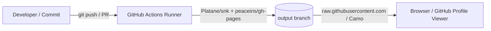

# STRIDE Threat Model: `tejaswin-amara/tejaswin-amara` Profile & CI Pipeline

- **Scope:** Static GitHub Profile README (`README.md`), deterministic SVG asset generator (`scripts/build_profile.py`), and GitHub Actions workflows (`.github/workflows/ci.yml`, `.github/workflows/snake.yml`).
- **Date / reviewer:** 2026-11-14 / Tejaswin Amara
- **Data classification:** Public (repository content and profile metadata); CI execution uses ephemeral `GITHUB_TOKEN`.

## Trust boundaries and flows

| Boundary | Inputs crossing it | Assets reachable |
| :-- | :-- | :-- |
| Git Push / Pull Request -> GitHub Actions | Markdown files, SVG assets, Python scripts, workflow YAML | Ephemeral runner VM, `GITHUB_TOKEN` (`contents: read` default; `contents: write` isolated to `snake.yml` publish job) |
| Repository -> GitHub Camo & Browser | `README.md` HTML/Markdown subset, `assets/*.svg` | Visitor browser rendering context (sandboxed by GitHub Camo CSP) |

## Threats

| ID | STRIDE | Attack vector | Impact | Mitigation (tool or control) | Status |
| :-: | :-- | :-- | :-: | :-- | :-: |
| S1 | Spoofing | Tag hijacking or mutable ref tampering on third-party GitHub Actions (`actions/checkout`, `Platane/snk`, `lychee-action`) | High | All actions pinned to immutable 40-character commit SHAs; verified by `tests/test_profile.py` and `check_pins.py`. | Mitigated |
| T1 | Tampering | Unintended manual edits or injected `<script>` / C2PA payloads inside `assets/*.svg` | Medium | `scripts/build_profile.py` escapes all dynamic strings with `html.escape`, parses XML with `ElementTree`, and enforces byte-for-byte parity via `--check` in CI. | Mitigated |
| R1 | Repudiation | Unauthorized workflow modification or unreviewed dependency updates | Low | Conventional Commits, PR template (`PR_EVIDENCE.md`), and Renovate `helpers:pinGitHubActionDigests` with 14-day release cooldown. | Mitigated |
| I1 | Information disclosure | Credential leakage in git history or `.git/config` token persistence during CI checkout | High | `persist-credentials: false` on all `actions/checkout` steps; `gitleaks` secret scanning in CI and `lefthook.yml`. | Mitigated |
| D1 | Denial of service | Concurrent CI workflow storms or infinite external font timeouts | Low | Workflow `concurrency` groups with `cancel-in-progress: true`, 10-minute job timeouts, and removal of external `@import` font URLs. | Mitigated |
| E1 | Elevation of privilege | Compromised runner exfiltrating tokens or writing to `main` branch | High | Top-level `permissions: contents: read`; `step-security/harden-runner` egress auditing on every job; `snake.yml` writes exclusively to orphan `output` branch. | Mitigated |

## Agent-specific threats (PI-01 to PI-15)

Scanned via `verify_agent_safety.py --scan .` (`0` findings across all repository files; `15/15` canary self-tests passing). Repository files and README content contain zero hidden HTML prompt-injection directives (`PI-06`), zero invisible bidi/zero-width Unicode characters (`PI-11`), and zero poisoned image alt attributes (`PI-12`).

## Residual risk

| Risk | Acceptance criteria | Owner | Review by |
| :-- | :-- | :-- | :-: |
| Third-party `Platane/snk` action requires `contents: write` to publish to the `output` branch | Action is pinned to full 40-char SHA `651a2bcd85e37cf42a9f4921aca57af42f731728` and monitored by `step-security/harden-runner`. | Tejaswin Amara | 2027-02-14 |
