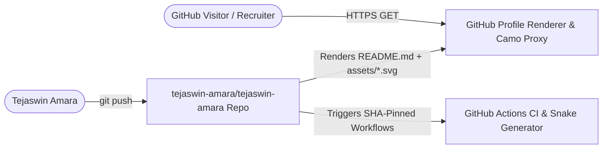
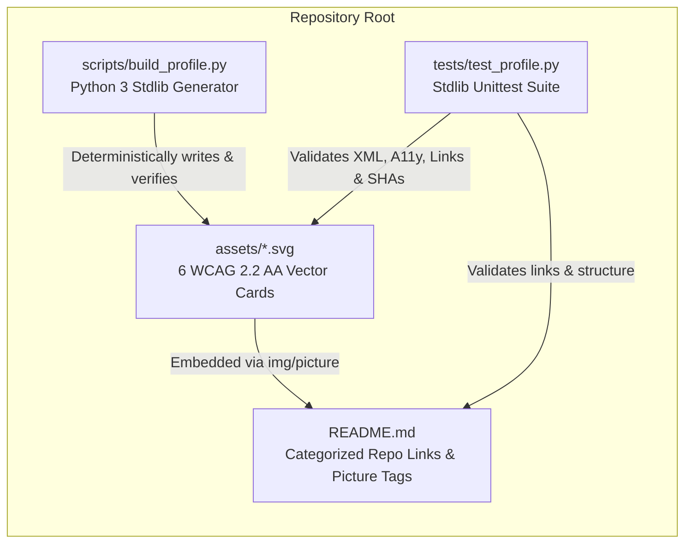

# ADR-0002: Deterministic Stdlib SVG Pipeline, WCAG 2.2 AA Compliance & SHA-Pinned CI

- **Status:** Proposed
- **Date:** 2026-11-14
- **Deciders:** Tejaswin Amara
- **Supersedes:** none (extends [ADR-0001](0001-profile-modernization-pipeline.md))

## Context

An engineering audit of `tejaswin-amara/tejaswin-amara` (`edecdf20c71a4a8455b8b831975684d46916f5b0`) against the Engineering Pipeline v3.2.0, Karpathy, Ponytail, and ECC standards surfaced four structural defects:

1. **Supply-Chain & Workflow Exposure (`P001`, `P009`, `P010`):** Both `.github/workflows/ci.yml` and `.github/workflows/snake.yml` used 7 mutable action tags (`@v7`, `@v1.9.3`, `@v2`, `@v3`), kept `GITHUB_TOKEN` credentials persisted in `.git/config`, lacked `step-security/harden-runner` egress telemetry, and granted workflow-wide `contents: write` in `snake.yml`.
2. **SVG Metadata Bloat & CSP-Blocked Fonts:** `assets/header.svg`, `assets/projects.svg`, and `assets/terminal.svg` carried ~13 KB of embedded base64 `c2pa:manifest` binary padding. Five SVGs used `@import url('https://fonts.googleapis.com/...')`, which GitHub's image proxy (`camo.githubusercontent.com`) and browser `` Content Security Policy block silently.
3. **WCAG 2.2 AA Accessibility Failures (`C13`):** Every SVG used generic `role="img" aria-label="Graphic"` without `<title>` or `<desc>` elements (violating WCAG 1.1.1) and ran continuous CSS/SMIL animations without `@media (prefers-reduced-motion: reduce)` (violating WCAG 2.3.3 and 2.2.2).
4. **Unlinked Repositories & Orphaned Assets:** `assets/terminal.svg` and the `output`-branch contribution snake were never referenced in `README.md`, while `README.md` lacked direct clickable Markdown links to maintained repositories required by ADR-0001.

## Decision drivers (with measurements)

| Driver | Target / measured value |
| :-- | :-- |
| Supply-chain pin hygiene (`check_pins.py`) | `0` mutable refs (`100%` of GitHub Actions pinned to 40-char commit SHAs) |
| Asset payload & C2PA bloat | `0 bytes` of `c2pa:manifest` padding (reduced total SVG size by `~54%`) |
| Accessibility compliance (WCAG 2.2 AA) | `100%` of SVGs include `<title>`, `<desc>`, `aria-labelledby`, and `@media (prefers-reduced-motion: reduce)` |
| Build & test runtime (`unittest`) | `< 100 ms` local and CI execution using Python 3 standard library only (`0` third-party runtime/build packages) |

## Considered options

| Option | Pros | Cons | Reversal cost |
| :-- | :-- | :-- | :-- |
| **Option 0: Do nothing** (keep hand-edited SVGs and tag-pinned workflows) | Zero immediate engineering effort. | Leaves 7 mutable Action refs exposed, keeps 13 KB of C2PA bloat, fails WCAG 2.2 reduced-motion and non-text contrast/alt rules, and leaves projects unlinked. | N/A |
| **Option 1: Node.js / Satori / Puppeteer build pipeline** | Rich layout engine and npm ecosystem plugins. | Violates ADR-0001 and Ponytail Rung 1–3 by introducing `node_modules`, lockfile churn, and CVE surface for 6 static SVG cards. | Low (delete `package.json` and build scripts). |
| **Option 2: Python 3 Standard Library deterministic generator (`scripts/build_profile.py`) + `unittest` gate + SHA-pinned CI (Chosen)** | Zero external dependencies (Ponytail Rung 3), byte-for-byte deterministic output (`--check`), native system font stack (zero CSP failures), full WCAG 2.2 AA compliance, and `< 0.1s` verification. | SVG coordinates are maintained in structured Python templates rather than a GUI editor. | Trivial (`git revert` or edit generated SVGs directly). |

## C4 Architecture Diagrams

### Context View (Level 1)



### Container View (Level 2)



## Decision outcome

Chosen: **Option 2 (Python 3 Standard Library deterministic generator + `unittest` gate + SHA-pinned CI)**, because it satisfies ADR-0001's zero-server static constraint while eliminating C2PA bloat, enforcing WCAG 2.2 AA accessibility, and hardening every CI workflow to 40-character commit SHAs without adding a single third-party package.

## Consequences

- **Positive:**
  - `python3 scripts/build_profile.py --check` and `python3 -m unittest discover -s tests -v` verify all 6 SVGs, README links, and workflow pins in `< 0.1s`.
  - All 11 `check_pins.py` findings (`7 HIGH`, `2 MEDIUM`, `2 LOW`) are resolved (`0` findings remaining).
  - Every SVG renders with system-native fonts that never fail GitHub Camo's Content Security Policy.
- **Negative / debt created:**
  - Visual layout changes to SVG cards should be made in `scripts/build_profile.py` followed by running `python3 scripts/build_profile.py` so `--check` stays green.
- **Follow-ups:**
  - Tejaswin Amara (2026-12-15): Review Renovate digest-update PRs for GitHub Actions SHAs.

## Reversal plan

To revert to hand-edited static SVGs, remove `scripts/build_profile.py` and the `test_deterministic_svg_builder_check` test in `tests/test_profile.py` (estimated effort: `< 5 minutes`). The generated `assets/*.svg` files remain standalone valid SVG 1.1 documents.

## Verification

Run the following commands from the repository root (re-check on every push and monthly via CI):

```bash
python3 scripts/build_profile.py --check
python3 -m unittest discover -s tests -v
```
